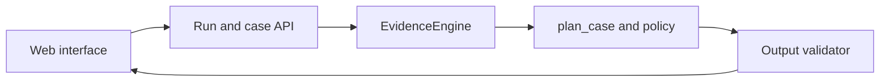

# Ghost Data UI Plan

## Product goal

Give privacy operations staff a clear way to review deletion audits, understand
why each case received its status, inspect the evidence available at
`audit_at`, and carry out the proposed remediation safely. The interface is a
review surface over the existing audit engine; it must not implement a second
set of identity, policy, or verdict rules.

## Visual direction

Follow the supplied reference: a calm, document-like audit tool with warm
neutrals, dense useful content, and verdict color used sparingly. Treat the
palette and type roles below as the UI tokens; do not add decorative gradients,
large shadows, oversized hero panels, or extra accent colors.

| Role | Token | Use |
| --- | --- | --- |
| Page background | `#F7F6F2` | Warm paper-like canvas |
| Cards and panels | `#FFFFFF` | Evidence and content surfaces |
| Borders | `#E2DFD6` | Thin 1 px separators instead of shadows |
| Primary text | `#1C1F23` | Main copy and table values |
| Secondary text | `#5F6368` | Labels and captions |
| Brand | `#1D3B47` | Headers and primary buttons |
| Link and information | `#2B5C8A` | Evidence links |
| Incomplete | `#A8322D` on `#F6E3E1` | Verdict chips only |
| Complete | `#2F6B4F` on `#E1EFE7` | Verdict chips only |
| Not applicable | `#6B7075` on `#ECEDEE` | Verdict chips only |
| Warning | `#9A6A12` on `#F5EAD2` | Unreadable evidence and warnings |

- Use IBM Plex Sans for headings and body text, and IBM Plex Mono for evidence
  IDs, system/resource IDs, and JSON.
- Keep typography left-aligned with a small hierarchy: one heading size, one
  body size, and one small size.
- Use 4, 8, 16, and 24 px spacing increments, 1 px borders, and square or
  lightly rounded content regions.
- Use compact tables, timelines, and evidence excerpts instead of large empty
  cards. Align numeric columns consistently.
- Pair every status color with an icon and text label. Use one consistent
  line-style icon set or plain text; do not mix icon styles.
- During background runs, show real progress as counts, active stage, elapsed
  time, and warnings. Animate only the active stage/progress indicator, keep
  motion subtle, and respect reduced-motion preferences. Never imply progress
  or completion that the runner has not reported.
- Keep one primary action per screen and use specific copy such as “Email still
  present in regional replica (evidence_12)” instead of vague alerts.
- Keep the workspace light and neutral. Do not copy the dark background of the
  reference document viewer as the product canvas.

## Primary users

- **Privacy analyst:** reviews a request, its identity links, findings, and
  evidence, then hands off ordered remediation.
- **Operations reviewer:** investigates cases that the evidence cannot support
  and records what additional evidence is needed.
- **Administrator:** selects a participant-facing dataset and starts or
  monitors an audit run.

## Main workflow

1. Select a dataset and request file, then run the audit.
2. Review the batch summary and filter cases by status, request type, warning,
   or manual-review requirement.
3. Open a case to inspect authorization, resolved identity history, resource
   states, evidence, and the ordered remediation or verification steps.
4. Copy or export validated results. Block a complete batch export while any
   case has an unresolved evidence-review requirement.

## Screens

### 1. Run dashboard

- Dataset health: required files found, evidence extraction warnings, and
  request count.
- Run progress with processed, complete, incomplete, not-applicable, and
  review-required counts.
- A live run panel with the current stage, processed/total requests, elapsed
  time, and warning/error count. The animated indicator must track actual
  runner events; on unknown progress, show the process state and latest safe
  log line instead of a fabricated percentage.
- Recent runs with start time, input fingerprint, output path, and validation
  result.
- Clear explanation when a run stops before writing predictions.

### 2. Case list

- Search by case ID and filter by status, reported workflow status, warning,
  and review requirement.
- Show request time, audit cutoff, audit status, number of findings, and
  recreation risks.
- Keep personal identifiers masked in the list; do not place them in URLs.

### 3. Case workspace

- **Request and authorization:** request text, requested time, audit cutoff,
  and whether deletion is authorized, not authorized, or unclear.
- **Identity timeline:** current and historical identifiers with provenance;
  mask email and phone values by default.
- **Resource ledger:** one row per system/resource with category, state at the
  cutoff, policy treatment, confidence, and evidence reference.
- **Evidence drawer:** show the cited file, activity, or audit record with
  source, capture/event time, relevant excerpt, and whether it is a claim or a
  direct record observation. Hide evidence after `audit_at` from the verdict
  view.
- **Action plan:** render FINDING, REMEDIATION, and VERIFICATION in order, with
  evidence citations for findings and current-state checks.
- **Manual review panel:** explain the missing or conflicting evidence and
  identify what evidence would unblock the case; never invent a remedy.

### 4. Export and validation

- Preview the exact `case_id,deletion_status,steps_json` row before copying it.
- Validate step fields, evidence IDs, phase order, step numbering, and the full
  case set before enabling CSV export.
- Keep JSON and CSV exports deterministic and identical to CLI output for the
  same run.

## Architecture boundary

- Add a thin application/service layer around `EvidenceEngine`,
  `plan_case`, `CaseExplanation`, and the existing validator.
- Use Streamlit as the Python-first UI shell for the initial release; apply the
  visual tokens above through a small shared stylesheet and reusable layout
  helpers rather than styling each screen independently.
- Keep evidence extraction and planning in Python; the browser only displays
  returned, typed data.
- Return structured evidence references and excerpts so the UI never parses
  planner prose to reconstruct a verdict.
- Keep the CLI and UI on the same application service so they cannot disagree
  about identity resolution, cutoff handling, policy, or ordering.

## Privacy, safety, and accessibility

- Mask email, phone, and name by default; require a deliberate reveal action
  and avoid persisting revealed values in browser storage or URLs.
- Bind every finding and complete-case verification to a valid evidence ID.
- Mark operational log entries and workflow results as claims; distinguish
  them visually from database/document observations.
- Show the audit cutoff beside the timeline and exclude later evidence from
  verdict calculations.
- Never let a UI edit silently change the engine's status. Any reviewer note
  or correction must be explicit, attributable, and separate from the
  generated prediction.
- Support keyboard navigation, visible focus, readable contrast, screen-reader
  labels, and layouts that work on smaller screens.
- Keep run motion brief and functional; provide a reduced-motion mode and a
  clear static state for users who disable animation.

## Delivery phases

1. **Interaction prototype:** validate the run dashboard, case list, and case
   workspace using fictional sample cases; apply the supplied palette and
   typography; agree on labels and masked-value behavior.
2. **Read-only case review:** expose the shared application service and build
   the case list, resource ledger, evidence drawer, and explanation panel.
3. **Batch runs and review queue:** add progress, warnings, retry/resume, and
   manual-review handling without allowing unsupported exports.
4. **Validated export:** add CSV/JSON preview, full-set validation, and
   downloadable artifacts.
5. **Hardening:** review accessibility, privacy boundaries, error states,
   large-run performance, and parity with CLI output.

## Acceptance criteria

- For the same request and dataset, UI status and ordered steps exactly match
  the CLI result.
- Every displayed finding has a participant-visible evidence reference; every
  COMPLETE check cites evidence that establishes the state at `audit_at`.
- The UI visibly separates current evidence, operational claims, and proposed
  future work.
- A review-required run cannot be exported as a complete prediction file.
- Export passes the existing output validator and contains one lexically
  sorted row per request.
- Personal identifiers remain masked by default and never appear in URLs.

## Decisions to make before implementation

- Local single-user tool or authenticated multi-user service.
- Dataset path configured by an administrator or selected per run.
- Which evidence types need inline preview versus a safe local-file link.
- Whether reviewer notes are needed for the first release; notes must not
  alter generated results.
